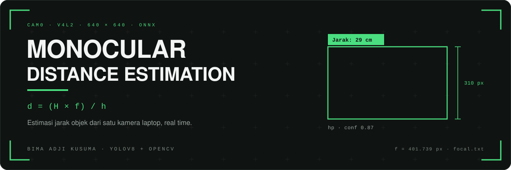

<p align="center">
  
</p>

<p align="center"><b>Estimasi jarak objek dari satu kamera, tanpa sensor kedalaman.</b></p>
<p align="center">YOLOv8 mendeteksi objek lewat ONNX, tinggi bounding box dipakai pada model pinhole, hasilnya tampil sebagai label jarak di frame.</p>

<p align="center">
  
  
  
  
</p>

<p align="center">
  <a href="#fitur">Fitur</a> ·
  <a href="#cara-kerja">Cara kerja</a> ·
  <a href="#prasyarat">Prasyarat</a> ·
  <a href="#build-dan-jalankan">Build</a> ·
  <a href="#kalibrasi">Kalibrasi</a> ·
  <a href="#konfigurasi">Konfigurasi</a> ·
  <a href="#kontributor">Kontributor</a>
</p>

---

## Fitur

- Deteksi objek YOLOv8 dari model ONNX 640×640 lewat modul `dnn` OpenCV
- Estimasi jarak real time untuk deteksi dengan confidence tertinggi
- Kalibrasi sekali tekan: tekan `c`, masukkan jarak asli objek, focal length disimpan ke `focal.txt`
- Label jarak dan penghitung FPS langsung di jendela OpenCV
- Log CSV dengan kolom `timestamp_ms`, `pixel_height`, `estimated_distance_cm`, `confidence`
- Backend CUDA bisa dimatikan lewat `runOnGPU` di `main.cpp`

---

## Cara kerja

Perhitungannya memakai model pinhole:

```
d = (H × f) / h
```

`d` jarak objek ke kamera (cm), `H` tinggi asli objek (cm), `f` focal length hasil kalibrasi (px), `h` tinggi bounding box (px).

`H` diisi manual lewat `REAL_HEIGHT_CM` di `main.cpp`, sekarang `23.0f`. `h` diambil dari tinggi box YOLO. `f` dibaca dari `focal.txt`, nilai terakhir `401.739` px.

Program hanya mengukur satu objek: deteksi dengan confidence tertinggi di frame itu.

---

## Prasyarat

- Linux dengan webcam, karena kode membuka kamera lewat `CAP_V4L2`
- OpenCV 4 dengan modul `dnn`
- CUDA 12.2 di `/usr/local/cuda-12.2`, karena `CMakeLists.txt` memakai `find_package(CUDA 12 REQUIRED)`
- CMake 3.5 atau lebih baru dan compiler C++17

---

## Build dan jalankan

```bash
mkdir build
cd build
cmake ..
make
./inferenceTest
```

Jendela `Estimasi Jarak YOLO` akan terbuka. Tekan `c` untuk kalibrasi, `ESC` untuk keluar.

---

## Kalibrasi

1. Ukur tinggi objek sebenarnya, lalu samakan `REAL_HEIGHT_CM` di `main.cpp`
2. Letakkan objek di jarak yang diketahui, misalnya 50 cm
3. Jalankan program sampai objek masuk bounding box
4. Tekan `c`, masukkan jarak tersebut dalam cm
5. `focal.txt` terisi otomatis

Kalibrasi ulang hanya perlu kalau kamera atau jenis objeknya berganti.

---

## Konfigurasi

`main.cpp` memakai path absolut `/home/bima/Monocular Distance Estimation/` untuk model, file kelas, `focal.txt`, dan `distance_log.csv`. Ganti ke path repo di mesin kamu sebelum build.

| Yang diubah | Lokasi |
|-------------|--------|
| Path model, classes, focal, log | `main.cpp`, konstruktor `Inference` dan blok `ifstream`/`ofstream` |
| Tinggi objek sebenarnya | `REAL_HEIGHT_CM` |
| GPU atau CPU | `runOnGPU` |
| Resolusi, FPS, format kamera | `cap.set(...)`, sekarang 800×600, MJPG, 60 fps |
| Path CUDA | `CMakeLists.txt` |
| Model dan daftar kelas | `best.onnx`, `classes.txt` (satu kelas: `hp`) |

---

## Isi repo

| File | Isi |
|------|-----|
| `main.cpp` | Loop kamera, kalibrasi, perhitungan jarak, overlay jarak dan FPS |
| `inference.cpp`, `inference.h` | Wrapper OpenCV dnn: decode YOLOv5/v8, NMS, input diubah ke kotak 640×640 |
| `best.onnx` | Model YOLOv8, input 640×640 |
| `classes.txt` | Nama kelas model, sekarang `hp` |
| `focal.txt` | Focal length hasil kalibrasi |
| `distance_log.csv` | Contoh log hasil pengukuran |
| `CMakeLists.txt` | Konfigurasi build |

---

## Catatan

- Objek harus utuh di dalam frame, dan kamera sebaiknya diam saat pengukuran
- Ketelitian bergantung pada kestabilan bounding box, karena hanya tinggi box yang dipakai
- Log ditulis ulang setiap program dijalankan

---

## Ide pengembangan

- Multi-object tracking dengan jarak per objek
- Grafik jarak real time
- Profil kalibrasi untuk tiap jenis objek
- GUI dengan Qt atau ImGui
- Estimasi pose 3D dari bounding box

---

## Kontributor

Bima Adji Kusuma, [bimaadjikusuma@gmail.com](mailto:bimaadjikusuma@gmail.com)
